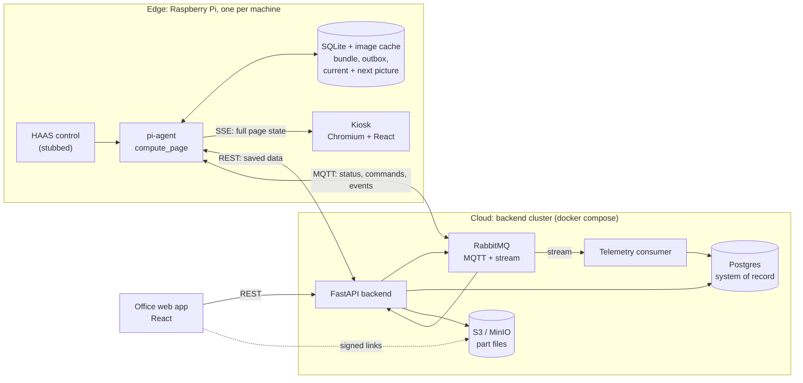
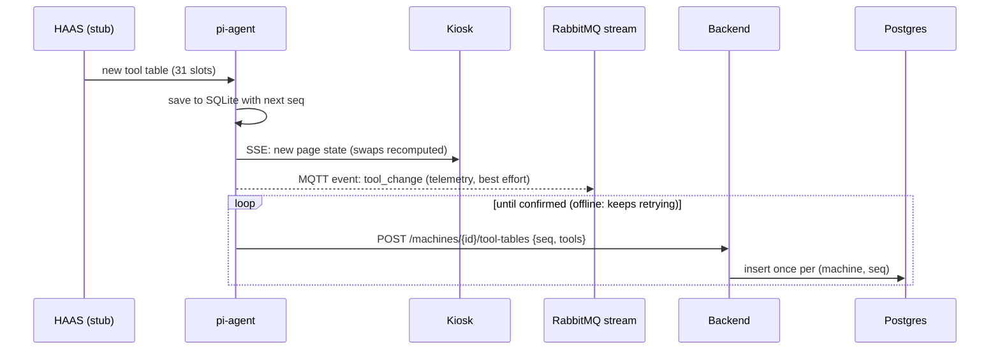
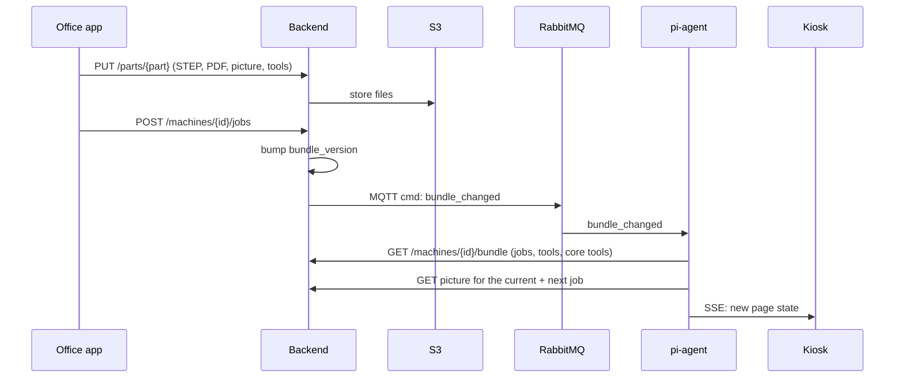
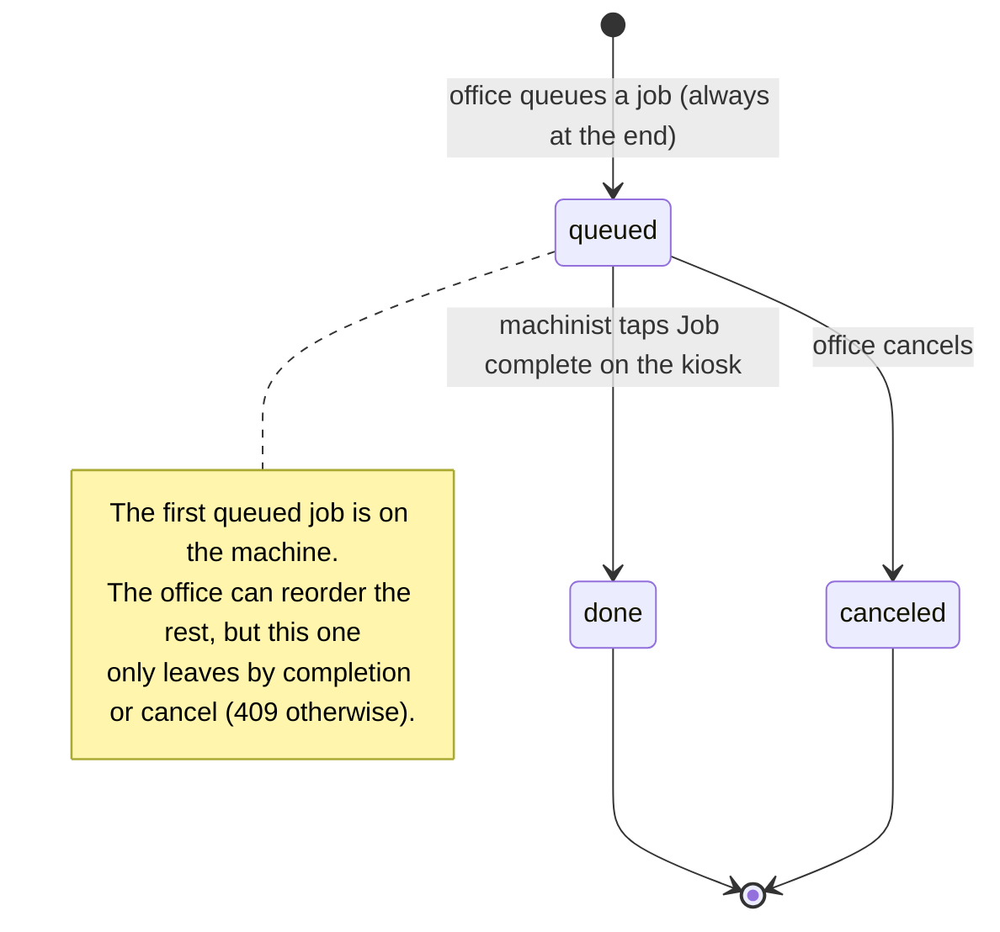
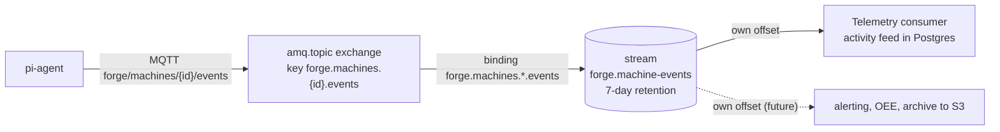
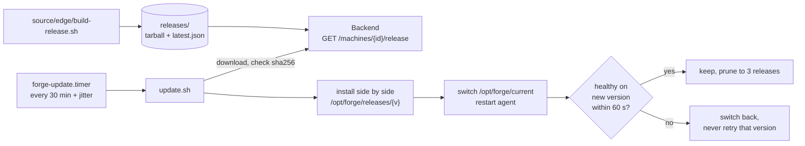

# Forge HAAS Talker — tool tracking skeleton

A Raspberry Pi on each HAAS machine shows the operator which tools are loaded, which need swapping,
and what part runs next. The Pi builds the page itself, so the screen survives network outages.
A shared backend cluster stores jobs, files and tool tables, tells each Pi when its jobs change,
and collects machine events on a RabbitMQ stream.

## Run it

One-time setup (Python 3.12, Node with pnpm, Docker):

```bash
python3.12 -m venv .venv && .venv/bin/pip install -e ".[backend,agent,dev]"
```

Start everything and load the demo jobs:

```bash
docker compose up -d --build
.venv/bin/python demo/load.py
```

| Open | What |
|---|---|
| http://localhost:3000 | **Office web app** (stand-in for Forge's web system): queue jobs with their files, reorder, cancel, watch machine activity |
| http://localhost:8080 | **Kiosk** for the simulated machine `haas-vf2-01`, as the operator sees it |
| http://localhost:8000/docs | Backend API |
| http://localhost:9001 | MinIO console: S3 bucket `forge-part-files`, region `ca-central-1` (forge / forge-secret) |
| http://localhost:15672 | RabbitMQ management: queues, the `forge.machine-events` stream (forge / forge) |

To start over (for example before a demo): `docker compose down -v`, then the two commands above.

### Demo data

`demo/jobs.json` lists three parts (with their tool lists) and three jobs. Put real files under
`demo/files/` at the paths it names: a STEP model, a PDF drawing and a picture per part. Missing
files are skipped. The loader uses the same API as the office app.

## Demo walkthrough

Each step says where it happens. The machine itself is the only thing without a UI, so its signals
(tool changes, cycle start/stop) are simulated with the agent's CLI.

1. **Office app → New job.** Drop a STEP, PDF and picture, then **Auto-fill from STEP**: it matches
   the STEP file name against parts on record (part number in the name, a file of the same name, or
   a similar name) and fills in the part number, material and tools. No match means a new part,
   numbered from the file name. Fill in the job and queue it. The files go to S3; the job goes to
   the end of the machine's queue.
2. **Kiosk.** The current job's part card with a large picture, and which tools to swap (orange) or
   put back in core indexes (red). If the part has no photo, the picture is a preview the backend
   rendered from its STEP file.
3. **Machine: a tool change.** The kiosk updates instantly; the office's *Machine activity* shows it.
   ```bash
   docker compose exec agent python -m agent set-slot 1 29     # load T29 into index 1
   docker compose exec agent python -m agent clear-slot 10     # empty core index 10: it goes red, -> T99
   ```
4. **Machine: a cycle.** Telemetry only; it shows up in *Machine activity*.
   ```bash
   docker compose exec agent python -m agent cycle start
   docker compose exec agent python -m agent cycle stop
   ```
5. **Kiosk → Job complete** (tap twice). The kiosk moves to the next job, its picture already cached.
   The office shows it under *Recently finished* as "Completed at machine".
6. **Office app → Job queue.** Reorder what comes next. The job on the machine is locked: it can only
   be canceled, and the kiosk then moves on.
7. **Offline.** Stop the backend; the kiosk shows an offline banner but keeps working: tool changes
   and *Job complete* still update the screen. Start it again and everything uploads.
   ```bash
   docker compose stop backend
   docker compose start backend
   ```

### Tests

```bash
.venv/bin/pytest                                         # page logic (from the production screenshot) + part auto-fill
(cd source/edge/kiosk && pnpm install && pnpm build)     # strict TypeScript check + build
(cd source/cloud/web && pnpm install && pnpm build)
```

## Architecture



The rule of thumb: **REST for anything that must be saved, MQTT for live signals.** Saved data
(tool tables, completions, jobs, files) is acknowledged, retried and idempotent. MQTT carries
presence, "your jobs changed" notices, and best-effort telemetry.

### A tool change on the machine



### A job queued in the office reaches the Pi



The agent also fetches its bundle on every reconnect and once a minute, so a missed notice only
delays an update.

### Job lifecycle



Completion comes from the machine, not from set times: cycle times drift with setups, scrap and
re-runs, so a timer would sometimes move the kiosk on while the part is still being cut. The agent
saves the completion locally, shows the next job right away, and reports it with
`POST /machines/{id}/jobs/{job_id}/complete`, retrying until confirmed (idempotent; a job the office
canceled meanwhile stays canceled). In production the Pi could also read the HAAS part counter to
show progress and prompt the machinist when the quantity is reached.

### Machine telemetry on a RabbitMQ stream



Pis publish `tool_change`, `cycle_start`, `cycle_stop` and `job_complete` events. RabbitMQ's MQTT
plugin turns topic levels into a routing key, and a binding copies the events into a **stream**: an
append-only log that consumers read without removing messages. Each consumer keeps its own position,
so more can be added (alerting, OEE, an archiver) and replay history. The telemetry consumer
(`source/cloud/backend/telemetry.py`) stores each event with its stream offset and resumes right after
the last one, so it catches up after downtime.

**Scaling:** 150 machines at 1–10 events/s is at most ~1,500 msg/s, well within one stream. The next
step is a **super stream partitioned by a hash of `machine_id`** (already in the routing key): it keeps
each machine's events in order and allows one consumer per partition. Machine type, cell or site
should not be the partition key, since that would skew load (a shop often runs many of one model) without
helping anyone filter. Use topic levels, stream filtering or machine attributes in Postgres for that.

Commands and presence stay on plain MQTT: a `cmd` message is for one Pi (a per-Pi session queue),
and `status` is the latest value (a retained message with a Last Will).

### The four questions

**1. How does the Pi talk to the backend?** REST for saved data, MQTT for live signals. Tool tables
and completions are saved locally first, then retried until the backend confirms; the backend stores
each one once. The Pi publishes a retained MQTT `status` with a Last Will of `offline`, and machine
events for the telemetry stream.

**2. How do we persist it?** Postgres is the system of record (`source/cloud/backend/db.py`): machines,
core tool slots, tools (with measured time), parts and their tools, the job queue and its history, every
tool table ever reported, machine status, and the machine-event feed. Part files live in S3 under
`parts/<part>/<sha256 prefix>-<filename>`, indexed by Postgres's `part_files` table. When a STEP file
is uploaded, the backend renders a PNG preview of the model in the background
(`source/cloud/backend/preview.py`: OpenCascade via cascadio and trimesh, drawn with matplotlib) and
stores it as the part's `preview`; an uploaded photo takes priority. Browsers get
short-lived signed links, so the bucket stays private. The Pi's SQLite is only a cache and an outbox.

**3. How does data get back to the Pi?** Notify over MQTT, fetch over REST (diagram above). Pictures
are cached for the current and next job only, fetched from `GET /machines/{id}/files/{file_id}` and
checked against their sha256.

**4. How is it shown as a kiosk?** The agent serves the React page on `localhost:8080` and pushes the
full page state over SSE on every change. If the backend is unreachable the screen keeps working and
shows "Offline since 14:02 — jobs as of 13:58". On the Pi, systemd runs the agent and full-screen
Chromium inside `cage`.

### Page rules (`source/shared/forge_core/page.py`)

- `-1` = empty slot (purple, shown as `T0`). A check = the tool is measured.
- Core indexes (10, 23–31 here; configured per machine) must hold their tool: grey when right
  (`IN USE` if needed), red with `-> T99` when missing or wrong.
- Other indexes: green + `IN USE` if needed, blue if not.
- Each needed tool that isn't loaded goes to the first non-empty index whose tool isn't needed,
  then the first empty index (orange `-> T29` pill). A needed tool sitting in the wrong core index
  counts as not loaded. Leftovers show as a warning on the part card.

## Layout

```
source/
  shared/
    forge_core/     Pydantic models + compute_page, used by both edge and cloud
    tests/          page logic tests
  edge/             runs on each machine's Raspberry Pi
    agent/          Pi agent (agent.py) + CLI (__main__.py)
    kiosk/          React + TypeScript page, built with pnpm, served by the agent
    pi/             install.sh, update.sh (OTA), systemd units, boot.html
    build-release.sh  packages an edge release for OTA
  cloud/            the backend cluster
    backend/        FastAPI app (app.py), schema + seed (db.py), S3 (storage.py), stream consumer (telemetry.py), auto-fill (suggest.py), STEP previews (preview.py)
    tests/          auto-fill tests
    web/            office web app, React + TypeScript, built with pnpm, served by its own nginx container
demo/               load.py + jobs.json + files/: demo parts, files and jobs, loaded through the API
pyproject.toml      one Python project; maps forge_core, backend, agent to their folders under source/
Dockerfile          one file, three targets: backend, web (cloud) and agent (edge, bundles the built kiosk)
docker-compose.yml  the cloud cluster plus one simulated Pi
```

## On a real Pi



**1. Publish a release** (dev machine or CI); the backend serves it to every Pi:

```bash
source/edge/build-release.sh 1.0.0
```

**2. Install once per Pi** (Raspberry Pi OS Lite, 64-bit). Copy `source/edge/pi/` to the Pi, then:

```bash
sudo ./install.sh --machine-id haas-vf2-01 --token <machine token> \
  --backend https://forge-backend.example --mqtt forge-mqtt.example
```

It installs `cage`, `chromium` and Python, creates the `forge` and `kiosk` users, writes
`/etc/forge/agent.env`, keeps logs in RAM (SD cards and power cuts), downloads the latest release,
and enables `forge-agent`, `forge-kiosk` (full-screen Chromium in `cage`) and `forge-update.timer`.

**3. Updates happen over the air** (diagram above). The random delay spreads a release across the
fleet. Force a check with `sudo systemctl start forge-update`; `GET /machines` shows each Pi's
`agent_version`. Tested end to end in a Debian container standing in for a Pi (fresh install,
upgrade, broken release rolled back); not yet run on Pi hardware.

The agent uses `Type=notify` with a 30 s watchdog, starts without network, and keeps SQLite in
`/var/lib/forge`.

## Assumptions and simplifications

- The HAAS read and machine signals are stubbed: the agent starts from the screenshot's table, and tool
  changes and cycle start/stop come from the CLI. A real `ToolTableSource` would query the control.
- The machine, its core tools and "measured" data are seeded in `source/cloud/backend/db.py`; parts,
  files and jobs come from `demo/load.py` or the office app. A part's tool list is typed in; in
  production it would come from the CAM program.
- STEP previews render in the backend process after the upload returns, and at startup for STEP files
  that don't have one yet. At larger scale this would be its own worker fed from a queue.
- Files upload through the backend (fine for drawings and small models); large files would go straight
  to S3 with presigned upload links. MinIO runs from Bitnami's archived image, since MinIO stopped
  publishing images to Docker Hub.
- Tables are created on startup; production would use Alembic migrations. The stream and its binding
  are declared by the telemetry consumer; production would declare them in RabbitMQ's definitions.
- Telemetry is best effort: paho keeps unsent events in memory while the Pi is offline, so a Pi restart
  during an outage loses them. Anything that must not be lost goes over REST.
- OTA: every machine gets the latest release; canary groups or per-machine pins would slot into
  `GET /machines/{id}/release`. Releases are verified by sha256 from the authenticated manifest;
  production should also sign them and ship an aarch64 wheelhouse instead of installing from PyPI.
- Endpoints for Forge's web system are unauthenticated; Pi endpoints use a per-machine token.
  TLS and real credentials are left to deployment.
- `source/edge/kiosk/src/types.ts` mirrors `source/shared/forge_core/models.py` by hand; at scale,
  generate it from the Pydantic JSON schema.

## Open questions for Forge

1. "First non-empty index" for swaps: we read it as non-empty *and not in use*, with empty slots only
   as a fallback. Is that right, and why prefer evicting over filling empty slots?
2. Where does the measured check come from in production?
3. Are core indexes the same on every machine?
4. With several jobs queued, should swaps consider only the active job?
5. What happens today when more tools are needed than slots are free?
6. How long is stale job data acceptable on the kiosk during an outage?
