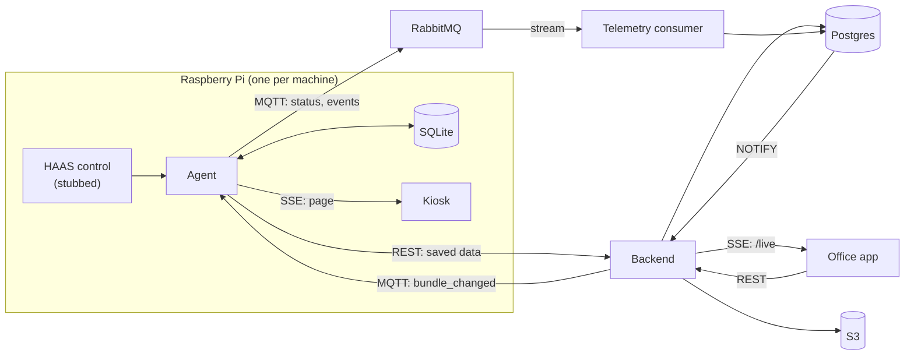
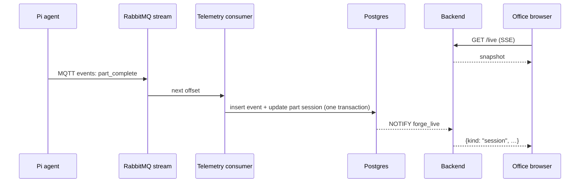

<<<<<<< HEAD
# Forge HAAS Talker
=======
# HAAStalker — tool tracking skeleton
>>>>>>> 9f07dc7a892cfeff6b6051fae1cbf11bd3e6644d

A Raspberry Pi on each HAAS machine shows the operator which tools are loaded, which to swap, and
what part runs next. The Pi builds that page itself, so the screen keeps working when the network
drops. A backend stores jobs, files and tool tables, and collects machine telemetry as **part
sessions** that the office watches live.

## Summary

| Question | Answer |
|---|---|
| How does the Pi talk to the backend? | **REST** for anything that must be saved (tool tables, completions). **MQTT** for live signals (presence, telemetry events). |
| How is data persisted? | **Postgres** is the system of record. Part files live in **S3** (MinIO here). The Pi's SQLite is only a cache and an outbox. |
| How does data get back to the Pi? | The backend sends a small MQTT notice, `bundle_changed`; the Pi then fetches its **bundle** (jobs, core tools, measured tools) over REST. |
| How is it shown as a kiosk? | The Pi agent serves a React page and pushes the full page state to it over **SSE** on every change. Chromium runs full screen. |
| How does the office see telemetry? | Events flow Pi → MQTT → **RabbitMQ stream** → consumer → Postgres. A Postgres trigger fires **NOTIFY**, and the backend pushes it to the browser over one SSE connection, with no polling. |

## Run it

Needs Python 3.12, Node with pnpm, and Docker.

```bash
python3.12 -m venv .venv && .venv/bin/pip install -e ".[backend,agent,dev]"
```

```bash
docker compose up -d --build
```

```bash
.venv/bin/python demo/load.py
```

| Open | What |
|---|---|
| http://localhost:3000 | Office web app: queue jobs, reorder, cancel, watch machines live |
| http://localhost:8080 | Kiosk for `haas-vf2-01` (add `?demo=1` for simulator controls) |
| http://localhost:8081, :8082 | Kiosks for `haas-vf2-02` and `haas-vf4-01` |
| http://localhost:8000/docs | Backend API |
| http://localhost:15672 | RabbitMQ: the `forge.machine-events` stream (forge / forge) |
| http://localhost:9001 | MinIO: bucket `forge-part-files` (forge / forge-secret) |

To start over, run `docker compose down -v` and then the last two commands again. `demo/load.py` adds its jobs every time it runs.

Run the simulator on every machine at once:

```bash
.venv/bin/python demo/fleet.py run --speed 20
```

## Modules

| Module | Runs on | What it does |
|---|---|---|
| `source/shared/forge_core` | both | Pydantic models and `compute_page`: the tool-slot rules, shared by Pi and cloud |
| `source/edge/agent` | Pi | Reads the tool table, builds the page, keeps SQLite, talks REST and MQTT, opens part sessions, runs the demo simulator (`sim.py`), CLI in `__main__.py` |
| `source/edge/kiosk` | Pi | React page the agent serves; shows slots, the current part, session progress and alerts |
| `source/edge/pi` | Pi | `install.sh`, systemd units, over-the-air updates (`update.sh`) |
| `source/cloud/backend/app.py` | cloud | FastAPI: REST for Pis and the office, MQTT presence and notices, the `/live` SSE stream |
| `source/cloud/backend/telemetry.py` | cloud | Reads the RabbitMQ stream into Postgres and keeps `part_sessions` up to date |
| `source/cloud/backend/sessions.py` | cloud | Turns events into part sessions: state times, cycle stats, parts made |
| `source/cloud/backend/notify.sql` + `live.py` | cloud | Postgres triggers that NOTIFY on changes, and the listener that fans them out to browsers |
| `source/cloud/backend/db.py` | cloud | Schema, migrations and seed data (machines, core tools, tool list) |
| `source/cloud/backend/storage.py`, `preview.py`, `suggest.py` | cloud | S3 files, PNG previews rendered from STEP, auto-fill from a STEP file name |
| `source/cloud/web` | browser | Office app: new job with files, job queue, live session progress and machine activity |
| `demo/` | your laptop | `load.py` (demo parts and jobs), `fleet.py` (drive every simulated Pi) |

`docker-compose.yml` runs Postgres, RabbitMQ, MinIO, the backend, the telemetry consumer, the
office app, and **three simulated Pis**, each with its own machine id, token, storage and kiosk port.



## What goes over REST

Pi endpoints need the header `X-Machine-Token`.

| Call | From | Purpose |
|---|---|---|
| `POST /machines/{id}/tool-tables` `{seq, tools[31], captured_at}` | Pi | Every tool-table change. Retried until confirmed; stored once per `(machine, seq)`. |
| `POST /machines/{id}/jobs/{job}/complete` `{completed_at}` | Pi | Machinist tapped **Job complete**. Retried, idempotent. |
| `GET /machines/{id}/bundle` | Pi | Jobs in run order, core tools, measured tools. Fetched on notice, on reconnect and every minute. |
| `GET /machines/{id}/files/{file}` | Pi | Picture for the current and next job, checked against its sha256. |
| `GET /machines/{id}/release` | Pi | Over-the-air update manifest. |
| `PUT /parts/{part}` (form + files) | office | Part, its tools, cycle time, STEP / PDF / picture to S3. |
| `POST /machines/{id}/jobs` | office | Queue a job (always at the end). |
| `PUT /machines/{id}/queue`, `POST /jobs/{job}/cancel` | office | Reorder or cancel. The job on the machine can only be canceled. |
| `GET /live` | office | The SSE stream (see below). |

## What goes over MQTT

All topics are `forge/machines/{machine_id}/…`. RabbitMQ's MQTT plugin carries them.

| Topic | Direction | Payload | Delivery |
|---|---|---|---|
| `status` | Pi → backend | `{online, agent_version, last_seq}` | Retained. A Last Will sets `{online: false}` if the Pi drops. |
| `cmd` | backend → Pi | `{type: "bundle_changed", version}` | QoS 1, persistent session: queued for a Pi that is offline. |
| `events` | Pi → stream | One machine event (below) | QoS 1, best effort. |

Every event has the same envelope:

```json
{"event_id": "…", "machine_id": "haas-vf2-01", "session_id": "…", "type": "part_complete",
 "at": "2026-11-25T16:10:56Z", "data": {"job_id": 11, "made": 3, "quantity": 30, "cycle_s": 241}}
```

| Event type | `data` |
|---|---|
| `session_start` | job, quantity, expected cycle time, the tool table at the start |
| `tool_change` | tool-table `seq` and which slots changed |
| `cycle_start` / `cycle_stop` | job, program; on stop, `duration_s` |
| `part_complete` | `made`, `quantity`, `cycle_s` |
| `feed_hold` / `resume` | none |
| `alarm` / `alarm_clear` | `code`, `message` |
| `quantity_reached`, `job_complete` | job |
| `session_end` | `reason` (completed or canceled), `made` |

## How streaming works

There are three streams, one per hop.

**1. Pi → kiosk (SSE, `GET /api/events` on the Pi).** On every change the agent sends the whole
page state: slots, the current job, session, alerts. The kiosk just renders it. No backend involved.

**2. Pi → Postgres (RabbitMQ stream).** RabbitMQ turns the MQTT topic into routing key
`forge.machines.{id}.events`, and a binding copies every event into the stream
`forge.machine-events`. It is an append-only log kept for 7 days. Readers don't remove messages, and
each tracks its own position. The telemetry consumer inserts each event once (by `event_id`) and
updates the event's part session in the same transaction. On restart it resumes after the last saved
offset, so nothing is skipped. Other readers (alerting, an S3 archiver) can be added later and replay history.

**3. Postgres → office (LISTEN/NOTIFY + SSE, `GET /live`).** Triggers in `notify.sql` fire
`pg_notify('forge_live', …)` when a machine event, part session, job, machine status or part file
changes. The backend holds one `LISTEN` connection and forwards each message to every open browser.
Each connection starts with a full snapshot, because NOTIFY isn't stored: a browser that reconnects
loses nothing. Measured on this stack, it takes 2–35 ms from the Pi's event to the NOTIFY.



## Part sessions

Every event belongs to a **part session**: one job's run on one machine.

- The Pi opens a session when a job reaches the machine, and closes it on **Job complete** or when the office cancels the job.
- The Pi creates the session id and stamps it on every event, so a session survives a reboot or an outage.
- In the cloud, `part_sessions` is built only from the event stream. It holds the state (setup,
  cutting, idle, feed hold, alarm), time spent in each, parts made, and last, average, minimum and
  maximum cycle times. Replaying the stream rebuilds it.

## Page rules

From the spec, in `source/shared/forge_core/page.py`:

- **Core indexes** (10, 23–31) must hold their tool: grey when right, **red** with `-> T99` when it's missing or wrong.
- **Other indexes:** green with `IN USE` if the job needs the tool, blue if not, purple if empty. A check mark means the tool is measured.
- **A needed tool that isn't loaded** goes to the first index holding a tool the job doesn't need,
  or else to the first empty index, shown in orange with `-> T29`. If there's nowhere to put it, the part card shows a warning.

Each simulated machine keeps its core tools at those indexes, but one core tool differs per machine
(`MACHINES` in `db.py`), so the same part needs different swaps on different machines.

## Demo walkthrough

1. **Office → New job.** Drop a STEP, PDF and picture, then **Auto-fill from STEP**. Queue it.
2. **Kiosk (`?demo=1`).** The job appears with its tool swaps. Tap an orange or red pill to load that tool.
3. **Kiosk → Run 20×.** The simulator cuts parts. The kiosk counts them, and the office's session line and activity feed update live.
4. **Kiosk → Feed hold or Alarm.** The state changes on both screens.
5. **Kiosk → Job complete** (tap twice). The session closes, and the next job loads with its picture already cached.
6. **Offline.** Run `docker compose stop backend`. The kiosk shows a banner and keeps working.
   Run `docker compose start backend`, and everything uploads.

The same actions from a terminal:

```bash
docker compose exec agent python -m agent sim run --speed 20
```

```bash
docker compose exec agent python -m agent set-slot 1 29
```

## Tests

```bash
.venv/bin/pytest
```

```bash
(cd source/edge/kiosk && pnpm install && pnpm build)
```

```bash
(cd source/cloud/web && pnpm install && pnpm build)
```

`pytest` covers the page rules, part sessions on the Pi, the cloud session projection and auto-fill.
The `pnpm` builds run strict TypeScript checks.

## On a real Pi

- **Install once:** copy `source/edge/pi/` to the Pi (Raspberry Pi OS Lite, 64-bit) and run
  `sudo ./install.sh --machine-id … --token … --backend … --mqtt …`. It sets up the agent, and
  Chromium full screen in `cage`, with logs in RAM to spare the SD card.
- **Publish a release:** run `source/edge/build-release.sh 1.0.0`. The backend serves it to every Pi.
- **Updates:** every 30 minutes, with random delay, each Pi checks for a release. It checks the sha256 and installs the
  new version alongside the old one. If the new version isn't healthy within 60 s, the Pi switches back and never
  retries it.
- Tested in a Debian container standing in for a Pi, not yet on Pi hardware.

## Assumptions

- The HAAS read is stubbed. Pis start from the screenshot's tool table, and tool changes, cycles and
  alarms come from the CLI or the simulator.
- Machines, core tools and the tool list are seeded in `db.py`; parts and jobs come from the office
  app or `demo/load.py`. In production, a part's tools would come from the CAM program.
- Telemetry is best effort: unsent events are held in memory while the Pi is offline and lost if it
  restarts mid-outage. Anything that must not be lost goes over REST.
- **Scale:** 150 machines at 1–10 events/s is about 1,500 msg/s, fine for one stream. The next step
  is a super stream partitioned by `machine_id`, which keeps each machine's events in order.
- In the simulator, state durations are measured in wall-clock time, so they shrink at 20×. Cycle times are reported in machine time.
- Tables are created at startup (production would use Alembic). Office endpoints have no auth.
  Files upload through the backend; large ones would use presigned S3 links.

## Open questions for Forge

1. Swaps go to the first non-empty index not in use, then empty ones. Is that the right order?
2. Where does the "measured" check come from?
3. Are core indexes the same on every machine?
4. Should swaps consider only the active job, or the next few?
5. What happens today when more tools are needed than slots are free?
6. How stale can job data be on the kiosk during an outage?
